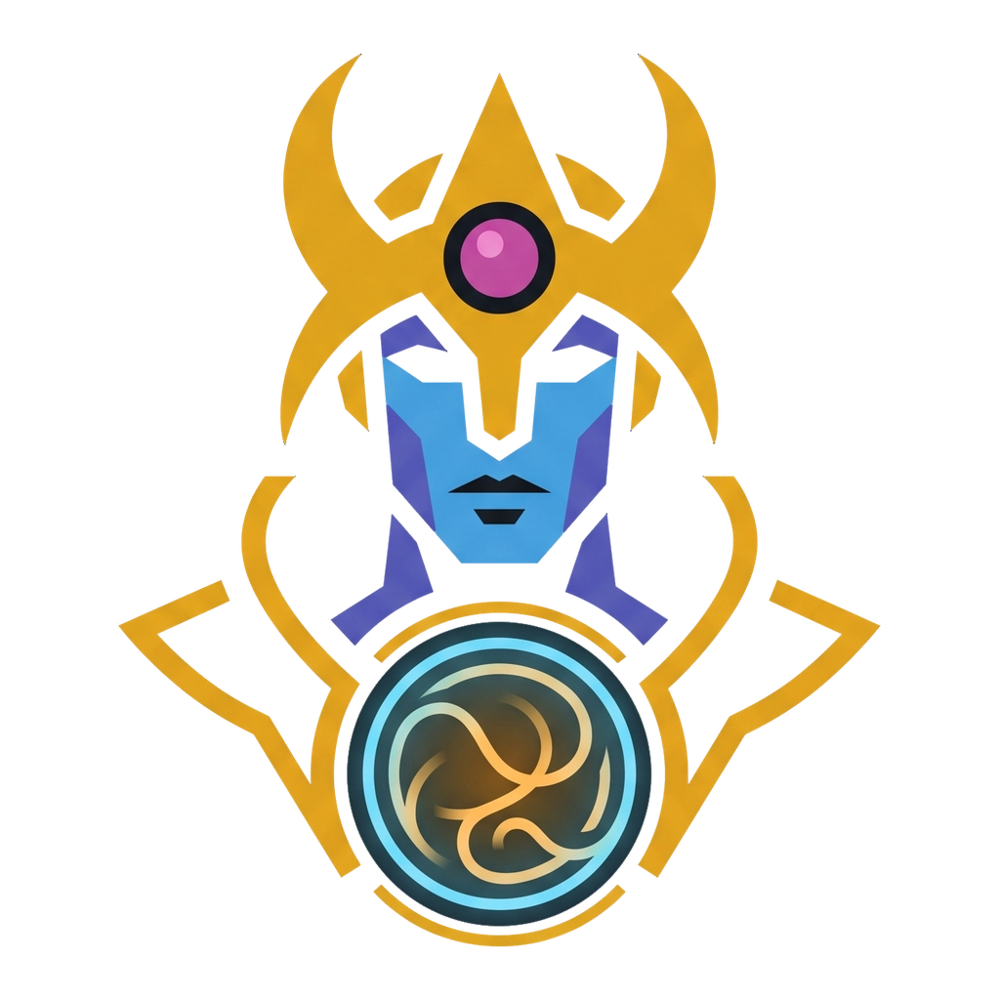
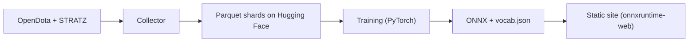

<p align="center">
  
</p>

<h1 align="center">d2oracle</h1>

<p align="center">
  Dota 2 draft analysis on Immortal and pro matches from the current patch.<br>
  Pick ten heroes and get lanes, game length, odds and a build for every hero. Runs entirely in your browser.
</p>

<p align="center">
  <a href="LICENSE"></a>
  <a href="https://huggingface.co/datasets/rizeru/d2oracle-data"></a>
  
  
</p>

<p align="center">
  <b>English</b> · <a href="README.ru.md">Русский</a> · <a href="README.uk.md">Українська</a>
</p>

---

## What you get

Put heroes into the ten slots (Radiant and Dire, positions 1–5). The forecast updates every time you change a pick:

- **Win odds** for both teams.
- **Lanes**: who is favoured on top, mid and bot, plus the expected gold and XP difference at 10:00.
- **Game length**: a typical window, e.g. "around 38 minutes, usually 33–44".
- **For each hero**: expected GPM, XPM, last hits, K/D/A, hero and tower damage, damage taken, healing, and that hero's share of the team total.
- **Build**: key items in order with the minute you'd usually finish them, skills for levels 1–18, and talents at 10/15/20/25.
- **Match pace**: switch between Auto, 25, 35 and 50 minutes to see how builds and stats change if the game turns out faster or slower than expected.

## Why it exists

Dota analytics sites are good at answering questions about **heroes**. Dotabuff, STRATZ and Dota2ProTracker show how a hero does in a given role, which heroes it beats in lane or pairs well with, and what high-ranked players build on it, filtered by bracket, position and facet. STRATZ also has a draft win predictor.

d2oracle tries to answer questions about **one specific match**: these ten heroes, in these roles. How will the lanes go, how long will the game last, and what should each hero build in this game?

Everything comes from a single model, so the answers fit together. If the model expects your carry to lose the lane, that hero's projected farm, item timings and build shift to match, because the item and stat predictions take the lane forecast into account.

The dataset is public and the whole pipeline is in this repo, from collecting data to the web page.

---

## How it works



### 1. Collecting matches

The collector is an async Python service. It runs on its own, finds new matches, checks them, and publishes them to the dataset.

**Where matches come from.** It uses four sources, in priority order:

1. **OpenDota `publicMatches`**: recent ranked games with an average rank of Immortal. It deliberately looks 1–3 hours back, because STRATZ needs time to parse a match. Fresher matches would come back empty.
2. **OpenDota `proMatches`**: league games. On first launch it also pages back to the start of the patch.
3. **Snowball through players.** Every accepted match adds its ten players to a local queue. In batches of ten, the collector asks STRATZ for those players' recent games from the current patch. High-ranked players mostly play with each other, so the pool grows by itself.
4. **Leaderboard fallback.** If the queue runs completely dry, it takes players from the regional leaderboards (Europe, Americas, SEA, China) and starts the snowball again.

There is no fixed MMR threshold anywhere. MMR inflates over time, so the collector relies on the Immortal bracket flag and league IDs instead.

**What gets thrown out.** Full match details come from STRATZ GraphQL, batched 20 matches per request. A match is kept only if:

- it's from the active patch, in the Immortal bracket, and either ranked (All Pick / Captains Mode) or a league Captains Mode game;
- it lasted at least 15 minutes;
- it's a clean 5v5 with no abandons, and every player has their own position from 1 to 5;
- item purchases and skill upgrades are present for all ten players.

Matches STRATZ hasn't finished parsing go back into the queue for a retry. Everything else is rejected with a logged reason.

**What gets stored.** Heroes and positions, result, duration, lane results, gold and XP lead at 10:00, final stats per player, the full purchase history with timestamps, and the order of skill and talent upgrades. Player accounts and nicknames never reach the public dataset. Steam IDs live only in the collector's local SQLite and are used only for the snowball.

Matches go out in batches as zstd-compressed Parquet files to [rizeru/d2oracle-data](https://huggingface.co/datasets/rizeru/d2oracle-data). Hero, item and ability data for the patch is merged from STRATZ and [dotaconstants](https://github.com/odota/dotaconstants) (an OpenDota project) into `vocab.json`.

**Patches.** Every hour the collector checks STRATZ for a new game version. When one comes out, it publishes whatever is left from the old patch and starts collecting the new one from scratch. Patch names are never hard-coded.

API limits are tracked separately per second, minute, hour and day, with a margin below the official caps. The live values come from STRATZ response headers.

### 2. The model

The model is a Transformer in two stages: first it predicts the match as a whole, then each hero within that match.

#### Input

Each of the ten slots is a hero, a position and a side. These are three learned embeddings, added together. A Transformer encoder (4 layers, 6 attention heads, width 192) lets every slot look at all the others. It learns on its own that, say, a Radiant offlaner meets the enemy carry in lane.

#### Stage 1: the match

| What | How it's computed |
|---|---|
| **Win** | From a summary of the whole draft, plus a separate pairwise term: one score for each hero in its position, synergy for every pair of allies, and counters for every pair of opponents. |
| **Duration** | Three numbers: a lower bound, a typical value, and an upper bound. |
| **Lanes** | For each lane, the model gathers the heroes who actually stand there (bot for Radiant is pos 1 + 5 vs Dire pos 3 + 4, and so on) and outputs three probabilities: Radiant wins, even, Dire wins. |
| **Leads at 10:00** | Gold and XP difference between the teams. |

#### Stage 2: each hero

The Stage-1 forecast is turned into a short vector for each slot, **from that slot's own team's point of view**: "we're expected to win at 58%, my lane is probably lost, the game is around 40 minutes". This vector reshapes the hero's representation through FiLM (a learned per-feature scale and shift). The hero heads then work with an understanding of how the game is likely to go.

The Match pace buttons on the site plug straight into this spot. They replace the predicted duration with yours, and the encoder runs again.

Items are generated by a separate small decoder (2 layers), one at a time, like words in a sentence. Each next item looks at what's already bought and at the whole draft. Along with each item it predicts the minute of purchase.

### 3. Training: what the model gets penalised for

Each output has its own loss. Before anything is added up, values are brought to a comparable scale (minutes in tens, gold in thousands, damage per minute in hundreds). Otherwise hero damage, measured in tens of thousands, would drown out everything else.

**Win.** The model outputs a probability. The penalty is log loss: if Radiant won and the model gave them 70%, the penalty is small; at 30%, it's about three times bigger; at 5%, it's huge. Being confidently wrong is the most expensive mistake. Labels are softened by 2% so the model doesn't push its odds towards 0% or 100%.

**Duration.** Pinball loss, a separate one for each of the three numbers. For the lower bound, overshooting costs three times more than undershooting. For the upper bound it's the reverse, and the middle number is penalised symmetrically. As a result, about half of real games land inside the predicted window, and the window gets wider for drafts where the outcome is less clear.

**Lanes.** The truth is STRATZ's lane result, collapsed into three classes (any win counts the same, regardless of margin). The penalty is minus the logarithm of the probability the model gave to what actually happened. If the model said "Radiant wins top, 80%" and top was lost, that hurts a lot. If it said "about 35/30/35" and the lane went even, the penalty is moderate. That teaches it to be confident only where the lane really is lopsided. Lanes STRATZ has no result for are skipped.

**Leads at 10:00.** Huber loss on the gold and XP gap in thousands. Small errors are penalised quadratically, large ones linearly, so a single match with an 8k lead doesn't pull the whole model towards itself. If a match has no leads data, that term is skipped.

**Damage and healing per minute.** Also Huber, but each stat has its own scale. For tower damage and healing the quadratic zone is wider: most heroes have nearly zero there, and a regular loss would teach the model to always answer "zero".

**Share of team total.** For each team, the model gives a split of damage, tower damage, damage taken and healing across its five heroes, adding up to 100%. The penalty is KL divergence between the predicted split and the real one.

**Economy and K/D/A.** GPM, XPM, last hits per minute, and kills, deaths and assists per 10 minutes, each as a range with pinball loss, the same as duration. The per-10-minute form lets the site rescale them to any game length.

**Skills.** At each of the 18 levels the model chooses among this hero's abilities, a talent, or attributes. Other heroes' abilities are masked out completely. The penalty is cross-entropy on what the player actually upgraded. A small attention block on top lets each level see what was probably taken before it, so the build doesn't fall apart. The site then enforces the game rules: ultimate at 6/12/18, rank caps, and no skill point at level 17.

**Talents.** Left or right on each of the four tiers, cross-entropy.

**Items.** Cross-entropy on the next item, plus Huber on its purchase minute. Only key items count: finished items from 800 gold and up, plus Blink, Shard, Rapier and Moon Shard. Consumables are dropped, Dagon levels are merged into one, and components that auto-combined into an item within 5 seconds are removed.

#### Winners' builds vs. honest stats

Items, skills and talents are **recommendations**, so the losing team's builds count with weight 0.35. The model learns mostly from builds that won, but still sees losing games for rarely picked heroes.

Duration, economy, damage and item timings are **forecasts**, so they're trained on everyone equally. Otherwise a hero in a bad draft would get projections that are too rosy.

#### Training schedule

1. **Phase one** (about a third of the epochs): only the encoder and the match-level heads.
2. Then the best Phase-one checkpoint is **frozen**, so it can't be broken.
3. **Phase two**: hero heads and the item decoder. At first they're often given the true game situation instead of the predicted one (true result, true lanes). That share drops from 50% to 15% over training, so by the end the model is used to its own forecasts, which is all it has on the site. True duration with slight noise is mixed in throughout, so the Match pace buttons keep having an effect.

Optimiser: AdamW with warmup and cosine decay, mixed precision, gradient clipping. 20 epochs by default.

#### How quality is checked

The newest 10% of matches go to validation. The split is by date, duplicates are removed by `match_id`, and the code fails if the same match ends up on both sides. Tracked metrics: win accuracy and Brier score, mean error in minutes for duration, lane accuracy, mean error in gold and XP at 10:00, error in GPM/XPM/damage, accuracy of next item and of skill at each level, and error in item purchase minute. Pro and pub matches are also reported separately.

### 4. On the site

The trained model is exported to ONNX (opset 17) as two files: the encoder (~12 MB) and the item decoder (~4 MB). Together with `vocab.json` the bundle is about 17 MB, and the browser downloads it once.

The site is a static React + TypeScript app built with Vite, hosted on GitHub Pages. Inference happens on your device via `onnxruntime-web` in single-threaded WebAssembly, so it doesn't need special server headers and works on plain static hosting. Nothing is sent to a server.

To make the model export cleanly and run in the browser, attention is written out as plain matrix multiplications, with no fused PyTorch kernels or recurrent layers. After each export, `verify_onnx.py` checks that PyTorch and ONNX Runtime give the same numbers. The browser also checks the schema versions of the model, the vocabulary and the dataset, and refuses to start on a mismatched set instead of quietly giving nonsense.

The draft is saved in the page URL, so you can share a link.

---

## Repository layout

```
d2oracle/
├── shared/            # constants, Parquet schema, vocab.json builder
├── collector/         # collector service
│   ├── discovery.py       # four match sources
│   ├── validator.py       # filters and conversion to dataset rows
│   ├── patch_manager.py   # patch tracking and switching
│   ├── rate_limit.py      # API limits
│   └── clients/           # STRATZ, OpenDota, Hugging Face
├── training/          # model, losses, training, ONNX export
│   ├── model.py
│   ├── losses.py
│   ├── dataset.py
│   ├── train.py
│   ├── export_onnx.py
│   ├── verify_onnx.py
│   └── d2oracle_train.ipynb
├── web/               # website (React + Vite + onnxruntime-web)
├── deploy/            # Dockerfile, docker-compose, systemd unit for the collector
└── tests/             # Python tests
```

## Running it

You'll need Python 3.11+ and [uv](https://docs.astral.sh/uv/). For the site you'll also need Node.js.

**Collector**

```bash
uv sync
cp .env.example .env   # add STRATZ_TOKEN and HF_TOKEN

uv run d2oracle-collector --dry-run --no-upload   # ~20 matches, local only
uv run d2oracle-collector                          # continuous collection
```

To run it as a service: `docker compose -f deploy/docker-compose.yml up -d`.

**Training**

The simplest option is to open `training/d2oracle_train.ipynb` in any Jupyter environment with a GPU. The notebook downloads the dataset from Hugging Face, trains the model, checks the export and packages the finished bundle for the site. Or from the command line:

```bash
uv sync --extra train
uv run python -m training.train --epochs 20
```

**Site**

```bash
cd web
npm install
npm run dev     # dev server
npm run build   # build into web/dist
```

The model files (`d2oracle_encoder.onnx`, `d2oracle_item_decoder.onnx`, `vocab.json`, `model_config.json`) go in `web/public/models/`.

**Checks**

```bash
uv run pytest && uv run ruff check .
cd web && npm run typecheck && npm test
```

## Thanks

- [STRATZ](https://stratz.com/): match data, lane results, game constants.
- [OpenDota](https://www.opendota.com/): finding public and pro matches, and the [dotaconstants](https://github.com/odota/dotaconstants) project.
- [ONNX Runtime](https://onnxruntime.ai/): running the model in the browser.

d2oracle is not affiliated with Valve. Dota 2 is a trademark of Valve Corporation.

## License

[MIT](LICENSE) © ElRizeru
