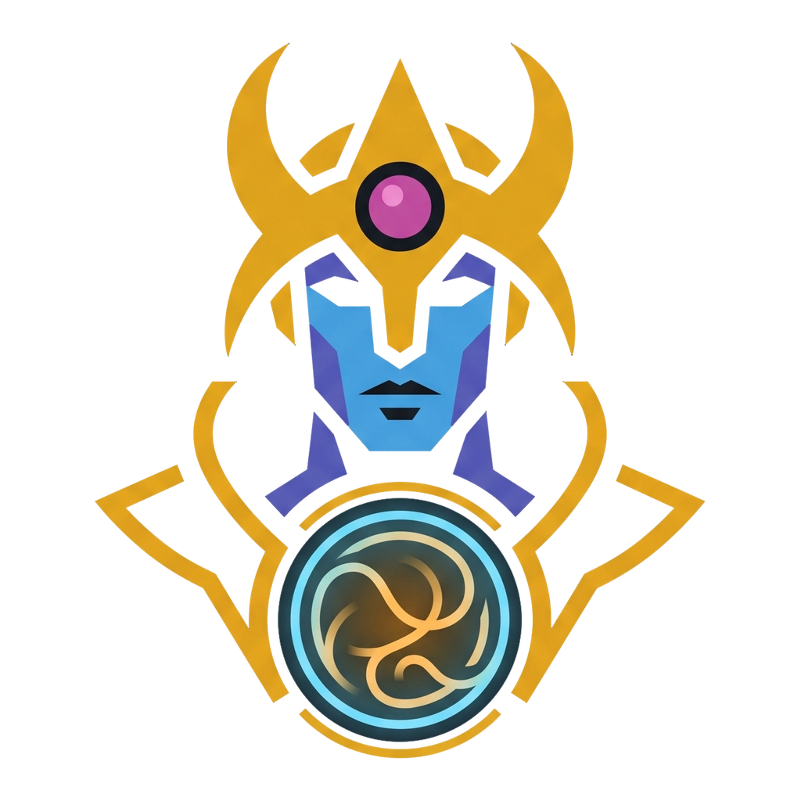
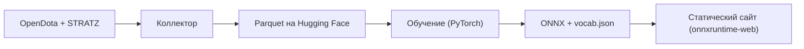

<p align="center">
  
</p>

<h1 align="center">d2oracle</h1>

<p align="center">
  Разбор драфта Dota 2 по матчам Immortal и про-сцены на текущем патче.<br>
  Выбираешь десять героев и видишь линии, длительность, шансы на победу и билд каждого героя. Всё считается прямо в браузере.
</p>

<p align="center">
  <a href="LICENSE"></a>
  <a href="https://huggingface.co/datasets/rizeru/d2oracle-data"></a>
  
  
</p>

<p align="center">
  <a href="README.md">English</a> · <b>Русский</b> · <a href="README.uk.md">Українська</a>
</p>

---

## Что показывает

Расставляешь героев по десяти слотам (Radiant и Dire, позиции 1–5). Прогноз пересчитывается при каждом изменении пика:

- **Шансы на победу** обеих команд.
- **Линии**: кто в плюсе на топе, миде и боте, и ожидаемая разница по золоту и опыту на 10-й минуте.
- **Длительность игры**: типичное окно, например «около 38 минут, обычно 33–44».
- **По каждому герою**: ожидаемые GPM, XPM, ластхиты, K/D/A, урон по героям и по строениям, получаемый урон, лечение и доля героя от всей команды.
- **Билд**: ключевые предметы по порядку с минутой, к которой их обычно собирают, прокачка скиллов с 1 по 18 уровень и таланты на 10/15/20/25.
- **Темп игры**: переключатель Auto / 25 / 35 / 50 минут. Показывает, как меняются билды и статистика, если игра пойдёт быстрее или дольше ожидаемого.

## Зачем это нужно

Сайты с аналитикой Доты хорошо отвечают на вопросы **о героях**. Dotabuff, STRATZ и Dota2ProTracker показывают, как герой играет на конкретной роли, кого он выигрывает на линии и с кем хорошо сочетается, что на нём собирают игроки высокого ранга. Всё это можно отфильтровать по рангу, позиции и аспекту. У STRATZ есть и предсказатель победы по драфту.

d2oracle пытается ответить на вопрос **о конкретном матче**: вот эти десять героев на этих ролях. Как пройдут линии, сколько продлится игра и что собирать каждому герою именно в этой игре?

Всё выдаёт одна модель, поэтому ответы согласованы между собой. Если она ждёт, что твой керри проиграет линию, то фарм, тайминги и сам билд этого героя тоже сдвинутся: прогнозы по предметам и статистике учитывают прогноз по линиям.

Датасет открыт, а весь путь от сбора данных до страницы сайта лежит в этом репозитории.

---

## Как это устроено



### 1. Сбор матчей

Коллектор работает как асинхронный сервис на Python: сам находит новые матчи, проверяет их и выкладывает в датасет.

**Откуда берутся матчи.** Источников четыре, в порядке приоритета:

1. **OpenDota `publicMatches`**: свежие рейтинговые игры со средним рангом Immortal. Коллектор специально смотрит на 1–3 часа назад, потому что STRATZ нужно время, чтобы распарсить матч. Более свежие игры приходят пустыми.
2. **OpenDota `proMatches`**: игры лиг и турниров. При первом запуске коллектор ещё и догружает их до начала патча.
3. **Снежный ком через игроков.** Каждый принятый матч добавляет своих десятерых игроков в локальную очередь. Пачками по десять коллектор запрашивает у STRATZ их последние игры на текущем патче. Игроки высокого ранга в основном играют друг с другом, так что пул растёт сам.
4. **Лидерборды как запасной вариант.** Если очередь совсем пустеет, коллектор берёт игроков из региональных лидербордов (Европа, Америка, Юго-Восточная Азия, Китай) и снова запускает снежный ком.

Фиксированного порога MMR нигде нет. MMR со временем инфлирует, поэтому коллектор опирается на флаг бракета Immortal и ID лиг.

**Что отсеивается.** Полные данные матча коллектор берёт через STRATZ GraphQL, по 20 матчей за запрос. Матч попадает в датасет, только если:

- он с актуального патча, из бракета Immortal и либо рейтинговый (All Pick / Captains Mode), либо турнирный в Captains Mode;
- длился не меньше 15 минут;
- это чистые 5 на 5 без ливеров, и у каждого игрока своя позиция от 1 до 5;
- у всех десяти игроков есть история покупок и прокачки.

Матчи, которые STRATZ ещё не распарсил, возвращаются в очередь на повтор. Всё остальное отбрасывается, причина записывается в лог.

**Что сохраняется.** Герои и позиции, результат, длительность, исходы линий, преимущество по золоту и опыту на 10:00, итоговая статистика каждого игрока, полная история покупок со временем и порядок прокачки скиллов и талантов. Аккаунты и ники игроков в публичный датасет не попадают. Steam ID хранятся только в локальной SQLite коллектора и нужны лишь для снежного кома.

Матчи уходят пачками в виде Parquet-файлов со сжатием zstd в [rizeru/d2oracle-data](https://huggingface.co/datasets/rizeru/d2oracle-data). Данные о героях, предметах и способностях на текущем патче собираются из STRATZ и [dotaconstants](https://github.com/odota/dotaconstants) (это проект OpenDota) в `vocab.json`.

**Патчи.** Раз в час коллектор проверяет в STRATZ, не вышла ли новая версия игры. Если вышла, он выгружает остатки по старому патчу и начинает собирать новый с нуля. Названия патчей нигде не зашиты в код.

Лимиты API считаются отдельно за секунду, минуту, час и сутки, с запасом ниже официальных. Актуальные значения берутся из заголовков ответов STRATZ.

### 2. Модель

В основе лежит трансформер в две ступени: сначала он предсказывает матч целиком, потом каждого героя внутри этого матча.

#### Вход

Каждый из десяти слотов задаётся героем, позицией и стороной. Эти три обучаемых эмбеддинга складываются вместе. Энкодер-трансформер (4 слоя, 6 голов внимания, ширина 192) даёт каждому слоту посмотреть на все остальные. Модель сама учится тому, что, например, оффлейнер Radiant стоит на линии против вражеского керри.

#### Первая ступень: матч

| Что | Как считается |
|---|---|
| **Победа** | По сводке всего драфта, плюс отдельное попарное слагаемое: оценка каждого героя на его позиции, синергия для каждой пары союзников и контрпик для каждой пары противников. |
| **Длительность** | Три числа: нижняя граница, типичное значение и верхняя граница. |
| **Линии** | Для каждой линии модель собирает героев, которые на ней реально стоят (например, на боте у Radiant стоят pos 1 + 5 против pos 3 + 4 у Dire), и выдаёт три вероятности: выиграл Radiant, ровно, выиграл Dire. |
| **Преимущество на 10:00** | Разница по золоту и опыту между командами. |

#### Вторая ступень: каждый герой

Прогноз первой ступени превращается в короткий вектор для каждого слота, **с точки зрения его собственной команды**: «мы побеждаем с шансом 58%, моя линия скорее проиграна, игра примерно на 40 минут». Этот вектор меняет представление героя через FiLM (обучаемый масштаб и сдвиг для каждого признака). Головы героя работают уже с пониманием того, как, скорее всего, пойдёт игра.

Кнопки «Темп игры» на сайте подключаются именно сюда. Они подменяют предсказанную длительность твоей, и энкодер пересчитывается заново.

Предметы генерирует отдельный небольшой декодер (2 слоя), по одному, как слова в предложении. Каждый следующий предмет смотрит на уже купленные и на весь драфт. Вместе с предметом декодер предсказывает минуту покупки.

### 3. Обучение: за что модель штрафуют

У каждого выхода свой штраф. Перед сложением все величины приводятся к сопоставимому масштабу (минуты измеряются десятками, золото тысячами, урон в минуту сотнями). Иначе урон по героям, который измеряется десятками тысяч, заглушил бы всё остальное.

**Победа.** Модель выдаёт вероятность. Ошибки штрафуются через логарифмическую функцию потерь: если Radiant выиграл, а модель дала ему 70%, штраф маленький; при 30% он примерно втрое больше; при 5% огромный. Уверенная ошибка обходится дороже всего. Метки смягчены на 2%, чтобы модель не загоняла шансы к 0% или 100%.

**Длительность.** Pinball loss, отдельный для каждого из трёх чисел. Для нижней границы перелёт стоит втрое дороже недолёта, для верхней всё наоборот, а среднее число штрафуется симметрично. В итоге примерно половина реальных игр попадает в предсказанное окно, а для драфтов с неясным исходом окно становится шире.

**Линии.** Правильный ответ берётся из STRATZ и сводится к трём классам (победа на линии с любым перевесом считается одинаково). Штраф равен минус логарифму вероятности, которую модель дала тому, что произошло на самом деле. Если модель сказала «топ за Radiant, 80%», а топ проигран, это очень больно. Если она сказала «примерно 35/30/35», а линия вышла ровной, штраф умеренный. Так модель учится быть уверенной только там, где линия действительно перекошена. Линии, по которым у STRATZ нет исхода, пропускаются.

**Преимущество на 10:00.** Huber loss по разнице в золоте и опыте, в тысячах. Маленькие ошибки штрафуются квадратично, а большие уже линейно, поэтому один матч с перевесом в 8k не перетягивает всю модель на себя. Если в матче нет данных о преимуществе, это слагаемое пропускается.

**Урон и лечение в минуту.** Тоже Huber, но у каждой характеристики свой масштаб. Для урона по строениям и лечения квадратичная зона шире: у большинства героев там почти ноль, и обычный штраф научил бы модель всегда отвечать «ноль».

**Доля от команды.** Для каждой команды модель раскладывает урон, урон по строениям, получаемый урон и лечение на пятерых героев, в сумме 100%. Здесь используется KL-дивергенция между предсказанной раскладкой и реальной.

**Экономика и K/D/A.** GPM, XPM, ластхиты в минуту, а также убийства, смерти и ассисты на 10 минут; каждое значение предсказывается как диапазон с pinball loss, как и длительность. Запись «на 10 минут» позволяет сайту пересчитать их под любую длину игры.

**Скиллы.** На каждом из 18 уровней модель выбирает между способностями этого героя, талантом и атрибутами. Способности других героев полностью замаскированы. Потери считаются по кросс-энтропии от того, что игрок на самом деле вкачал. Небольшой блок внимания сверху даёт каждому уровню видеть, что, скорее всего, взяли до него, чтобы билд не разваливался. Сайт потом следит за правилами игры: ульта на 6/12/18, потолок уровней скиллов, нет очка навыка на 17-м уровне.

**Таланты.** Левый или правый на каждом из четырёх уровней, кросс-энтропия.

**Предметы.** Кросс-энтропия по следующему предмету и Huber по минуте его покупки. Учитываются только ключевые предметы: собранные артефакты от 800 золота, а также Blink, Shard, Rapier и Moon Shard. Расходники выкидываются, уровни Dagon сводятся в один, а компоненты, которые автоматически собрались в предмет в пределах 5 секунд, убираются.

#### Билды победителей и честная статистика

Предметы, скиллы и таланты работают как **рекомендации**, поэтому билды проигравшей команды идут с весом 0.35. Модель учится в основном на выигравших билдах, но всё равно видит проигранные игры по редким героям.

Длительность, экономика, урон и тайминги предметов строятся как **прогнозы**, поэтому они учатся на всех одинаково. Иначе герой в плохом драфте получал бы слишком радужные цифры.

#### Порядок обучения

1. **Первая фаза** (примерно треть эпох): только энкодер и головы матча.
2. Затем лучший чекпоинт первой фазы **замораживается**, чтобы его нельзя было испортить.
3. **Вторая фаза**: головы героев и декодер предметов. Сначала им часто подают настоящую игровую ситуацию вместо предсказанной (реальный результат, реальные линии). Эта доля снижается с 50% до 15% за время обучения, так что к концу модель привыкает к собственным прогнозам (на сайте у неё есть только они). Реальная длительность с небольшим шумом подмешивается всё время, чтобы кнопки «Темп игры» продолжали работать.

Оптимизатор: AdamW с разогревом и косинусным затуханием, смешанная точность, клиппинг градиентов. По умолчанию 20 эпох.

#### Как проверяется качество

Самые новые 10% матчей уходят в валидацию. Разбиение идёт по дате, дубли убираются по `match_id`, а если один и тот же матч окажется по обе стороны, код падает с ошибкой. Отслеживаемые метрики: точность предсказания победы и Brier score, средняя ошибка длительности в минутах, точность по линиям, средняя ошибка по золоту и опыту на 10:00, ошибка GPM/XPM/урона, точность следующего предмета и скилла на каждом уровне, ошибка минуты покупки предмета. Про-матчи и пабы дополнительно считаются отдельно.

### 4. На сайте

Обученная модель экспортируется в ONNX (opset 17) двумя файлами: энкодер (~12 МБ) и декодер предметов (~4 МБ). Вместе с `vocab.json` набор весит около 17 МБ, и браузер скачивает его один раз.

Сайт сделан как статическое приложение на React + TypeScript, собран через Vite и размещён на GitHub Pages. Модель работает на твоём устройстве через `onnxruntime-web` в однопоточном WebAssembly, поэтому ей не нужны особые заголовки сервера и хватает обычного статического хостинга. На сервер ничего не отправляется.

Чтобы модель чисто экспортировалась и работала в браузере, внимание расписано обычными матричными умножениями, без слитых ядер PyTorch и рекуррентных слоёв. После каждого экспорта `verify_onnx.py` проверяет, что PyTorch и ONNX Runtime выдают одинаковые числа. Браузер тоже сверяет версии схем модели, словаря и датасета и отказывается запускаться на несовместимом наборе, а не тихо выдаёт ерунду.

Драфт сохраняется в адресе страницы, так что ссылкой можно поделиться.

---

## Структура репозитория

```
d2oracle/
├── shared/            # константы, схема Parquet, сборка vocab.json
├── collector/         # сервис-коллектор
│   ├── discovery.py       # четыре источника матчей
│   ├── validator.py       # фильтры и перевод в строки датасета
│   ├── patch_manager.py   # отслеживание и смена патчей
│   ├── rate_limit.py      # лимиты API
│   └── clients/           # STRATZ, OpenDota, Hugging Face
├── training/          # модель, функции потерь, обучение, экспорт в ONNX
│   ├── model.py
│   ├── losses.py
│   ├── dataset.py
│   ├── train.py
│   ├── export_onnx.py
│   ├── verify_onnx.py
│   └── d2oracle_train.ipynb
├── web/               # сайт (React + Vite + onnxruntime-web)
├── deploy/            # Dockerfile, docker-compose, unit systemd для коллектора
└── tests/             # тесты на Python
```

## Запуск

Понадобятся Python 3.11+ и [uv](https://docs.astral.sh/uv/). Для сайта ещё нужен Node.js.

**Коллектор**

```bash
uv sync
cp .env.example .env   # добавить STRATZ_TOKEN и HF_TOKEN

uv run d2oracle-collector --dry-run --no-upload   # ~20 матчей, только локально
uv run d2oracle-collector                          # непрерывный сбор
```

Запуск как сервиса: `docker compose -f deploy/docker-compose.yml up -d`.

**Обучение**

Проще всего открыть `training/d2oracle_train.ipynb` в любом Jupyter-окружении с GPU. Ноутбук сам скачивает датасет с Hugging Face, обучает модель, проверяет экспорт и упаковывает готовый набор для сайта. Или из командной строки:

```bash
uv sync --extra train
uv run python -m training.train --epochs 20
```

**Сайт**

```bash
cd web
npm install
npm run dev     # сервер для разработки
npm run build   # сборка в web/dist
```

Файлы модели (`d2oracle_encoder.onnx`, `d2oracle_item_decoder.onnx`, `vocab.json`, `model_config.json`) кладутся в `web/public/models/`.

**Проверки**

```bash
uv run pytest && uv run ruff check .
cd web && npm run typecheck && npm test
```

## Благодарности

- [STRATZ](https://stratz.com/): данные матчей, исходы линий, игровые константы.
- [OpenDota](https://www.opendota.com/): поиск публичных и турнирных матчей, а также проект [dotaconstants](https://github.com/odota/dotaconstants).
- [ONNX Runtime](https://onnxruntime.ai/): работа модели в браузере.

d2oracle не связан с Valve. Dota 2 является товарным знаком Valve Corporation.

## Лицензия

[MIT](LICENSE) © ElRizeru
