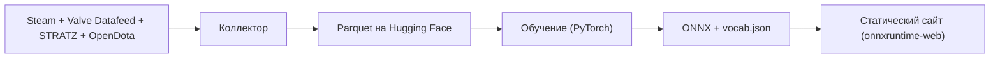

<p align="center">
  
</p>

<h1 align="center">d2oracle</h1>

<p align="center">
  Разбор драфта Dota 2 по матчам Immortal и про-сцены на текущем патче.<br>
  Мгновенный разбор линий, длительности, шансов на победу и билда каждого героя по десяти слотам драфта. Всё считается прямо в браузере.
</p>

<p align="center">
  <a href="LICENSE"></a>
  <a href="https://huggingface.co/datasets/rizeru/d2oracle-data"></a>
  
  
</p>

<p align="center">
  <a href="README.md">English</a> · <b>Русский</b> · <a href="README.uk.md">Українська</a>
</p>

---

## Что показывает

Герои расставляются по десяти слотам (Radiant и Dire, позиции 1–5). Прогноз пересчитывается при каждом изменении пика:

- **Шансы на победу** обеих команд.
- **Линии**: кто в плюсе на топе, миде и боте, и ожидаемая разница по золоту и опыту на 10-й минуте.
- **Длительность игры**: типичное окно, например «около 38 минут, обычно 33–44».
- **По каждому герою**: ожидаемые GPM, XPM, ластхиты, K/D/A, урон по героям и по строениям, получаемый урон, лечение и доля героя от всей команды.
- **Билд**: ключевые предметы по порядку с минутой, к которой их обычно собирают, прокачка скиллов с 1 по 18 уровень и таланты на 10/15/20/25.
- **Темп игры**: переключатель Auto / 25 / 35 / 50 минут. Показывает, как меняются билды и статистика, если игра пойдёт быстрее или дольше ожидаемого.

## Зачем это нужно

Сайты с аналитикой Доты хорошо отвечают на вопросы **о героях**. Dotabuff, STRATZ и Dota2ProTracker показывают, как герой играет на конкретной роли, кого он выигрывает на линии и с кем хорошо сочетается, что на нём собирают игроки высокого ранга. Всё это можно отфильтровать по рангу и позиции.

d2oracle пытается ответить на вопрос **о конкретном матче**: вот эти десять героев на этих ролях. Как пройдут линии, сколько продлится игра и что собирать каждому герою именно в этой игре?

Всё выдаёт одна модель, поэтому ответы согласованы между собой. Если модель ожидает, что керри проиграет линию, то фарм, тайминги и сам билд этого героя тоже сдвинутся: прогнозы по предметам и статистике учитывают прогноз по линиям.

Датасет открыт, а весь путь от сбора данных до страницы сайта лежит в этом репозитории.

---

## Как это устроено



### 1. Сбор матчей

Коллектор работает как асинхронный сервис на Python: сам находит новые матчи, проверяет их и выкладывает в датасет.

**Откуда берутся матчи.** Используются пять взаимодополняющих источников:

1. **Живые игры Steam (`GetTopLiveGame` / `GetLiveLeagueGames`)**: находит активных игроков высокого рейтинга и про-сцены напрямую с серверов Valve.
2. **OpenDota `proMatches`**: игры лиг и турниров. При первом запуске коллектор ещё и догружает их до начала патча.
3. **OpenDota `publicMatches`**: свежие рейтинговые игры со средним рангом Immortal (с лагом 1–3 часа, чтобы STRATZ успел распарсить реплей).
4. **Снежный ком через игроков.** Каждый принятый матч добавляет своих десятерых игроков в локальную очередь. Пачками по десять коллектор запрашивает у STRATZ (и при необходимости через Steam `GetMatchHistory`) их последние игры на текущем патче.
5. **Лидерборды как запасной вариант.** Если очередь пустеет, коллектор берёт игроков из региональных лидербордов (Европа, Америка, Юго-Восточная Азия, Китай) и снова запускает снежный ком.

Фиксированного порога MMR нигде нет. MMR со временем инфлирует, поэтому коллектор опирается на флаг бракета Immortal и ID лиг.

**Связка Steam, STRATZ и OpenDota.** Данные матчей забираются пачками по 20 через STRATZ GraphQL и дополняются из Steam `GetMatchHistoryBySequenceNum` (с объединением близких sequence number):

- **Steam Web API** даёт эталонную базовую статистику матча и игроков (K/D/A, GPM, XPM, урон, финальные предметы) и полную историю `ability_upgrades` (исправляет нулевые ID талантов STRATZ на новых героях вроде Kez/Largo и обрезку прокачки по уровню).
- **STRATZ** даёт глубокую реплей-аналитику: подтверждение бракета Immortal, позиции (1–5), исходы линий, преимущество по золоту и опыту на 10:00, получаемый урон и тайминги покупок.
- **OpenDota `/matches/{id}`** при необходимости добирает тайминги покупок (в пределах свободного лимита запросов) для про- и паб-матчей, где в финальном инвентаре Steam есть ключевые предметы, пропущенные в STRATZ.

**Что отсеивается.** Матч попадает в датасет, только если:

- он с актуального патча, из бракета Immortal и либо рейтинговый (All Pick / Captains Mode), либо турнирный в Captains Mode;
- длился не меньше 15 минут;
- это чистые 5 на 5 без ливеров, и у каждого игрока своя позиция от 1 до 5;
- у всех десяти игроков есть история покупок и прокачки.

Матчи, которые STRATZ ещё не распарсил или Steam ещё не отдал, возвращаются в очередь на повтор. Всё остальное отбрасывается, причина записывается в лог.

**Что сохраняется.** Герои и позиции, результат, длительность, исходы линий, преимущество по золоту и опыту на 10:00, итоговая статистика каждого игрока, полная история покупок со временем и порядок прокачки скиллов и талантов. Аккаунты и ники игроков в публичный датасет не попадают. Steam ID хранятся только в локальной SQLite коллектора и нужны лишь для поиска матчей.

Матчи уходят пачками в виде Parquet-файлов со сжатием zstd в [rizeru/d2oracle-data](https://huggingface.co/datasets/rizeru/d2oracle-data). Словарь героев, предметов, рецептов и талантов `vocab.json` собирается прежде всего из официального Valve Dota 2 Datafeed и дополняется данными STRATZ и [dotaconstants](https://github.com/odota/dotaconstants).

**Патчи.** Раз в час коллектор проверяет и официальный `patchnoteslist` от Valve, и `gameVersions` STRATZ. Когда выходит новый патч, коллектор выгружает остатки старого и сразу переключается на новый — даже в первый день, пока сторонние трекеры ещё не обновились. Названия патчей нигде не зашиты в код.

Лимиты API считаются отдельно за секунду, минуту, час и сутки с запасом ниже официальных потолков (включая 100 тыс./сутки у Steam и живые заголовки STRATZ/OpenDota).

### 2. Модель

В основе лежит трансформер в две ступени: сначала он предсказывает матч целиком, потом каждого героя внутри этого матча.

#### Вход

Каждый из десяти слотов задаётся эмбеддингами героя и позиции (без привязки к стороне на входе). Сайд-эквивариантный трансформер первой ступени (2 слоя, 6 голов внимания, ширина 192, FFN 384) обменивается контекстом через обучаемые **относительные сдвиги внимания «союзник / противник»**, а пустые слоты маскируются. Это делает оценки первой ступени инвариантными к перестановке Radiant и Dire.

#### Первая ступень: матч

| Что | Как считается |
|---|---|
| **Победа** | **Билинейная факторизационная машина (FM)** с L2-регуляризацией (сила героя и герой×позиция, синергия союзников, антисимметричные контрпики, сдвиг сильнейшей стороны) плюс ограниченный через `tanh` антисимметричный остаток от трансформера для многогеройных связок. Перед второй ступенью логиты калибруются температурой на валидации. |
| **Длительность** | Три числа: нижняя граница, типичное значение и верхняя граница — считаются симметрично к смене сторон. |
| **Линии** | Общая зеркальная голова боковых линий (Safe vs Off для Топа и Бота) и симметрично-антисимметричная голова Мида предсказывают 5 градаций исхода STRATZ (stomp / win / tie) и сводят их в три вероятности: выиграл Radiant, ровно, выиграл Dire. |
| **Преимущество на 10:00** | Антисимметричная разница по золоту и опыту между командами. |

#### Вторая ступень: каждый герой

Прогноз первой ступени превращается в короткий вектор для каждого слота, **с точки зрения его собственной команды**: «мы побеждаем с шансом 58%, моя линия скорее проиграна, игра примерно на 40 минут». На второй ступени работают **собственные эмбеддинги героя, позиции и стороны** (с нелинейным смешением герой×роль для флекс-пиков): они объединяются с замороженным представлением первой ступени, модулируются через FiLM от сценария и дорабатываются отдельным **2-слойным трансформером второй ступени**, прежде чем попасть в головы героев.

Кнопки «Темп игры» на сайте подключаются именно сюда. Они подменяют предсказанную длительность выбранной пользователем, и вторая ступень с декодером предметов пересчитываются заново.

Предметы генерирует отдельный небольшой декодер (2 слоя), по одному, как слова в предложении. Каждый следующий предмет смотрит на уже купленные и на весь драфт. Вместе с предметом декодер предсказывает минуту покупки.

### 3. Обучение: за что модель штрафуют

У каждого выхода свой штраф. Перед сложением все величины приводятся к сопоставимому масштабу (минуты измеряются десятками, золото тысячами, урон в минуту сотнями). Иначе урон по героям, который измеряется десятками тысяч, заглушил бы всё остальное.

**Победа.** Логарифмическая функция потерь со смягчением меток 1% (`0.01`) плюс изотропная L2-регуляризация на факторы билинейной FM, чтобы редкие связки не улетали в переуверенные крайности.

**Длительность.** Pinball loss, отдельный для каждого из трёх чисел. Для нижней границы перелёт стоит втрое дороже недолёта, для верхней всё наоборот, а среднее число штрафуется симметрично. В итоге примерно половина реальных игр попадает в предсказанное окно, а для драфтов с неясным исходом окно становится шире.

**Линии.** Кросс-энтропия, объединяющая 3-классовые вероятности (`Radiant / Ровно / Dire`) с полными 5 градациями STRATZ (разгром линии, обычная победа, ничья). Линии, по которым у STRATZ нет исхода, пропускаются.

**Преимущество на 10:00.** Huber loss по разнице в золоте и опыте, в тысячах. Маленькие ошибки штрафуются квадратично, а большие уже линейно, поэтому один матч с перевесом в 8k не перетягивает всю модель на себя. Если в матче нет данных о преимуществе, это слагаемое пропускается.

**Урон и лечение в минуту.** Тоже Huber, но у каждой характеристики свой масштаб. Для урона по строениям и лечения квадратичная зона шире: у большинства героев там почти ноль, и обычный штраф научил бы модель всегда отвечать «ноль».

**Доля от команды.** Для каждой команды модель раскладывает урон, урон по строениям, получаемый урон и лечение на пятерых героев, в сумме 100%. Здесь используется KL-дивергенция между предсказанной раскладкой и реальной.

**Экономика и K/D/A.** GPM, XPM, ластхиты в минуту, а также убийства, смерти и ассисты на 10 минут; каждое значение предсказывается как диапазон с pinball loss, как и длительность. Запись «на 10 минут» позволяет сайту пересчитать их под любую длину игры.

**Скиллы.** На каждом из 18 уровней модель выбирает между способностями этого героя и атрибутами (а таланты выбираются независимо на уровнях 10, 15, 20 и 25). Способности других героев полностью замаскированы. Небольшой причинный блок внимания даёт каждому уровню видеть, что выбрано ранее, а штраф сочетает кросс-энтропию и дифференцируемый штраф за перебор рангов сверх лимита (с учётом исключений вроде Invoker или Meepo). Сайт потом строго соблюдает правила игры: прокачка ульты на 6/12/18 и потолок уровней способностей.

**Таланты.** Левый или правый на каждом из четырёх уровней, кросс-энтропия.

**Предметы.** Кросс-энтропия по следующему предмету и Huber по минуте его покупки (с более аккуратным порогом остановки `<EOS>` `0.25` на инференсе). Учитываются только ключевые предметы: собранные артефакты от 800 золота, а также Blink, Shard, Rapier и Moon Shard. Расходники выкидываются, уровни Dagon сводятся в один, а компоненты, которые автоматически собрались в предмет в пределах 5 секунд, убираются.

#### Билды победителей и честная статистика

Предметы, скиллы и таланты работают как **рекомендации**, поэтому билды проигравшей команды идут с весом 0.35. Модель учится в основном на выигравших билдах, но всё равно видит проигранные игры по редким героям.

Длительность, экономика, урон и тайминги предметов строятся как **прогнозы**, поэтому они учатся на всех одинаково. Иначе герой в плохом драфте получал бы слишком радужные цифры.

#### Порядок обучения

1. **Первая фаза** (до 8 эпох с ранней остановкой `patience=3` на облегчённом срезе тензоров первой ступени): только энкодер первой ступени, билинейная FM и головы матча.
2. Затем на лучшем чекпоинте первой фазы подбирается калибровочная температура победы `win_temperature` по валидационному log loss, и вся первая ступень **замораживается**, чтобы градиенты второй фазы не могли её испортить.
3. **Вторая фаза** (остаток до 20 эпох с ранней остановкой `patience=4`): выделенный трансформер второй ступени, головы героев и декодер предметов. Сначала им часто подают настоящую игровую ситуацию вместо предсказанной (реальный результат, реальные линии). Эта доля снижается с 50% до 15% за время обучения, так что к концу модель привыкает к собственным прогнозам (на сайте у неё есть только они). Реальная длительность с небольшим шумом подмешивается всё время, чтобы кнопки «Темп игры» продолжали работать.

Оптимизатор: AdamW (с отдельными группами шага и регуляризации для FM и трансформеров) с разогревом и косинусным затуханием, смешанная точность, клиппинг градиентов, компактное хранение индексов в `int16` и прямое кэширование тензоров на GPU при достаточном объёме VRAM (`batch_size=512` в Colab).

#### Как проверяется качество

Самые новые 10% матчей уходят в валидацию. Разбиение идёт по дате, дубли убираются по `match_id`, а если один и тот же матч окажется по обе стороны, код падает с ошибкой. Отслеживаемые метрики: точность предсказания победы, ROC-AUC, ECE и Brier score, средняя ошибка длительности в минутах, точность по линиям, средняя ошибка по золоту и опыту на 10:00, ошибка GPM/XPM/урона, точность следующего предмета и скилла на каждом уровне, доля нарушений лимита рангов и ошибка минуты покупки предмета. Про-матчи и пабы дополнительно считаются отдельно.

### 4. На сайте

Обученная модель экспортируется в ONNX (opset 17) двумя файлами: энкодер (~11 МБ) и декодер предметов (~4 МБ). Вместе с `vocab.json` набор весит около 15 МБ, и браузер скачивает его один раз.

Сайт сделан как статическое приложение на React + TypeScript, собран через Vite и размещён на GitHub Pages. Модель работает на устройстве пользователя через `onnxruntime-web` в однопоточном WebAssembly, поэтому ей не нужны особые заголовки сервера и хватает обычного статического хостинга. На сервер ничего не отправляется.

Чтобы модель чисто экспортировалась и работала в браузере, внимание расписано обычными матричными умножениями, без слитых ядер PyTorch и рекуррентных слоёв. После каждого экспорта `verify_onnx.py` проверяет, что PyTorch и ONNX Runtime выдают одинаковые числа. Браузер тоже сверяет версии схем модели, словаря и датасета и отказывается запускаться на несовместимом наборе, а не тихо выдаёт ерунду.

Драфт сохраняется в адресе страницы, так что ссылкой можно поделиться.

---

## Структура репозитория

```
d2oracle/
├── shared/            # константы, схема Parquet, Valve Datafeed и сборка vocab.json
├── collector/         # сервис-коллектор
│   ├── discovery.py       # Steam live, OpenDota, STRATZ BFS и лидерборды
│   ├── validator.py       # слияние Steam+STRATZ, фильтры и строки датасета
│   ├── patch_manager.py   # отслеживание патчей (Valve + STRATZ) и переключение
│   ├── rate_limit.py      # многооконные лимиты API
│   └── clients/           # Steam, STRATZ, OpenDota, Hugging Face
├── training/          # модель, функции потерь, обучение, экспорт в ONNX
│   ├── model.py
│   ├── losses.py
│   ├── dataset.py
│   ├── train.py
│   ├── export_onnx.py
│   ├── verify_onnx.py
│   └── d2oracle_train.ipynb
├── web/               # сайт (React + Vite + onnxruntime-web)
├── deploy/            # Dockerfile, docker-compose, unit systemd для коллектора
└── tests/             # тесты на Python
```

## Запуск

Понадобятся Python 3.11+ и [uv](https://docs.astral.sh/uv/). Для сайта ещё нужен Node.js.

**Коллектор**

```bash
uv sync
cp .env.example .env   # добавить STRATZ_TOKEN, STEAM_API_KEY и HF_TOKEN

uv run d2oracle-collector --dry-run --no-upload   # ~20 матчей, только локально
uv run d2oracle-collector                          # непрерывный сбор
```

Запуск как сервиса: `docker compose -f deploy/docker-compose.yml up -d`.

**Обучение**

Проще всего открыть `training/d2oracle_train.ipynb` в любом Jupyter-окружении с GPU. Ноутбук сам скачивает датасет с Hugging Face, обучает модель, проверяет экспорт и упаковывает готовый набор для сайта. Или из командной строки:

```bash
uv sync --extra train
uv run python -m training.train --epochs 20
```

**Сайт**

```bash
cd web
npm install
npm run dev     # сервер для разработки
npm run build   # сборка в web/dist
```

Файлы модели (`d2oracle_encoder.onnx`, `d2oracle_item_decoder.onnx`, `vocab.json`, `model_config.json`) кладутся в `web/public/models/`.

**Проверки**

```bash
uv run pytest && uv run ruff check .
cd web && npm run typecheck && npm test
```

## Благодарности

- [Valve / Steam Web API](https://developer.valvesoftware.com/wiki/Steam_Web_API) и Dota 2 Datafeed: официальная статистика матчей, прокачка скиллов/талантов и актуальные константы патча.
- [STRATZ](https://stratz.com/): реплей-аналитика матчей, роли, исходы линий и преимущество на 10:00.
- [OpenDota](https://www.opendota.com/): поиск публичных и турнирных матчей, а также проект [dotaconstants](https://github.com/odota/dotaconstants).
- [ONNX Runtime](https://onnxruntime.ai/): работа модели в браузере.

d2oracle не связан с Valve. Dota 2 является товарным знаком Valve Corporation.

## Лицензия

[MIT](LICENSE) © ElRizeru
