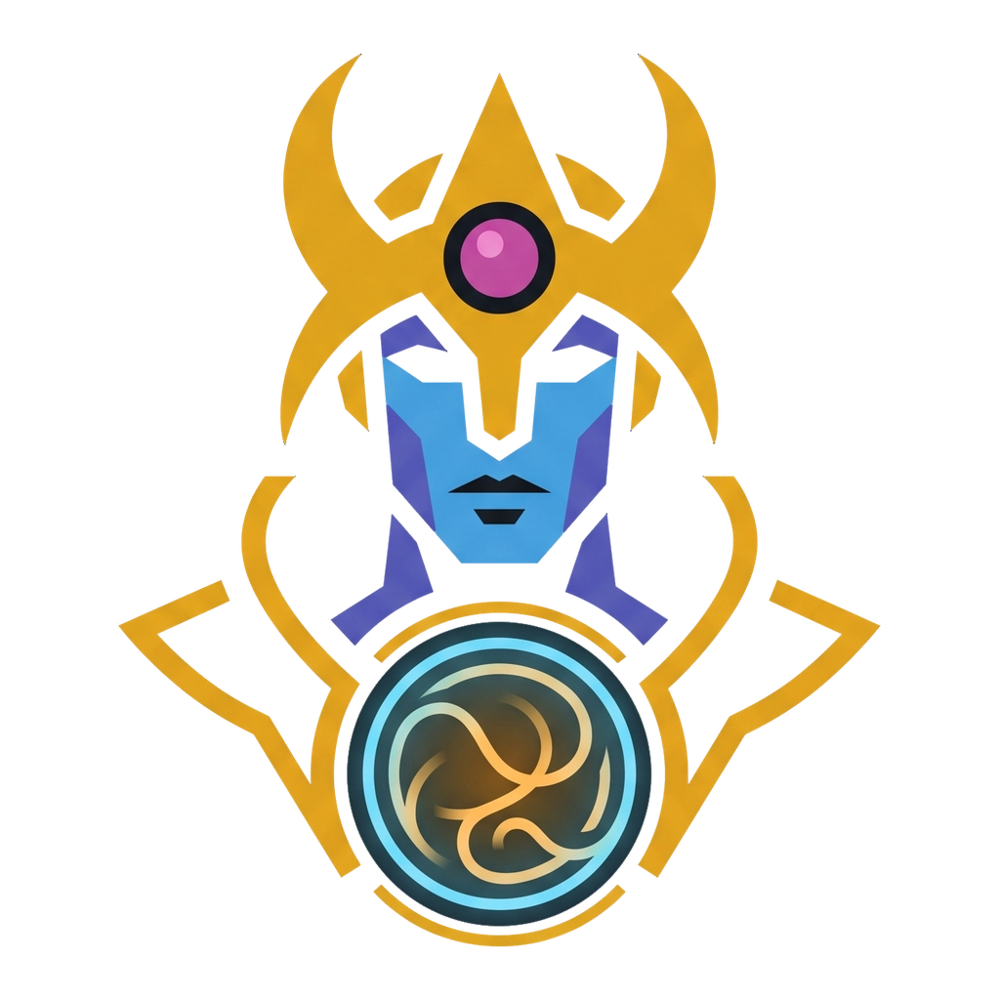
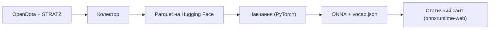

<p align="center">
  
</p>

<h1 align="center">d2oracle</h1>

<p align="center">
  Розбір драфту Dota 2 на матчах Immortal і про-сцени поточного патча.<br>
  Обираєш десять героїв і бачиш лінії, тривалість гри, шанси на перемогу та білд кожного героя. Усе рахується просто в браузері.
</p>

<p align="center">
  <a href="LICENSE"></a>
  <a href="https://huggingface.co/datasets/rizeru/d2oracle-data"></a>
  
  
</p>

<p align="center">
  <a href="README.md">English</a> · <a href="README.ru.md">Русский</a> · <b>Українська</b>
</p>

---

## Що показує

Розставляєш героїв у десять слотів (Radiant і Dire, позиції 1–5). Прогноз оновлюється після кожної зміни піку:

- **Шанси на перемогу** обох команд.
- **Лінії**: хто має перевагу на топі, міді та боті, і очікувана різниця в золоті та досвіді на 10-й хвилині.
- **Тривалість гри**: типове вікно, наприклад «близько 38 хвилин, зазвичай 33–44».
- **Для кожного героя**: очікувані GPM, XPM, ластхіти, K/D/A, шкода по героях і по спорудах, отримана шкода, лікування та частка героя від усієї команди.
- **Білд**: ключові предмети по черзі з хвилиною, до якої їх зазвичай збирають, прокачка скілів з 1 по 18 рівень і таланти на 10/15/20/25.
- **Темп гри**: перемикач Auto / 25 / 35 / 50 хвилин. Показує, як змінюються білди й статистика, якщо гра піде швидше або довше, ніж очікувалося.

## Навіщо це потрібно

Сайти з аналітикою Доти добре відповідають на питання **про героїв**. Dotabuff, STRATZ і Dota2ProTracker показують, як герой грає на конкретній ролі, кого він перемагає на лінії й з ким добре поєднується, що на ньому збирають гравці високого рангу. Усе це можна відфільтрувати за рангом, позицією та аспектом. У STRATZ є й передбачення перемоги за драфтом.

d2oracle намагається відповісти на питання **про конкретний матч**: ось ці десять героїв на цих ролях. Як пройдуть лінії, скільки триватиме гра і що збирати кожному героєві саме в цій грі?

Усе видає одна модель, тож відповіді узгоджені між собою. Якщо вона очікує, що твій керрі програє лінію, то фарм, таймінги й сам білд цього героя теж зсунуться: прогнози щодо предметів і статистики враховують прогноз щодо ліній.

Датасет відкритий, а весь шлях від збору даних до сторінки сайту лежить у цьому репозиторії.

---

## Як це влаштовано



### 1. Збір матчів

Колектор працює як асинхронний сервіс на Python: сам знаходить нові матчі, перевіряє їх і викладає в датасет.

**Звідки беруться матчі.** Джерел чотири, у порядку пріоритету:

1. **OpenDota `publicMatches`**: свіжі рейтингові ігри із середнім рангом Immortal. Колектор навмисно дивиться на 1–3 години назад, бо STRATZ потрібен час, щоб розпарсити матч. Свіжіші ігри приходять порожніми.
2. **OpenDota `proMatches`**: ігри ліг і турнірів. Під час першого запуску колектор ще й довантажує їх до початку патча.
3. **Сніжна куля через гравців.** Кожен прийнятий матч додає своїх десятьох гравців до локальної черги. Пачками по десять колектор запитує у STRATZ їхні останні ігри на поточному патчі. Гравці високого рангу переважно грають одне з одним, тож пул росте сам.
4. **Лідерборди як запасний варіант.** Якщо черга зовсім порожніє, колектор бере гравців із регіональних лідербордів (Європа, Америка, Південно-Східна Азія, Китай) і знову запускає сніжну кулю.

Фіксованого порогу MMR ніде немає. MMR з часом інфлює, тому колектор спирається на прапорець брекету Immortal та ID ліг.

**Що відсіюється.** Повні дані матчу колектор бере через STRATZ GraphQL, по 20 матчів за запит. Матч потрапляє в датасет, лише якщо:

- він з актуального патча, з брекету Immortal і або рейтинговий (All Pick / Captains Mode), або турнірний у Captains Mode;
- тривав щонайменше 15 хвилин;
- це чисті 5 на 5 без ліверів, і в кожного гравця своя позиція від 1 до 5;
- у всіх десятьох гравців є історія покупок і прокачки.

Матчі, які STRATZ ще не розпарсив, повертаються в чергу на повтор. Усе інше відкидається, причина записується в лог.

**Що зберігається.** Герої та позиції, результат, тривалість, результати ліній, перевага в золоті й досвіді на 10:00, підсумкова статистика кожного гравця, повна історія покупок із часом і порядок прокачки скілів і талантів. Акаунти й ніки гравців у публічний датасет не потрапляють. Steam ID зберігаються лише в локальній SQLite колектора й потрібні тільки для сніжної кулі.

Матчі вивантажуються пачками у вигляді Parquet-файлів зі стисненням zstd у [rizeru/d2oracle-data](https://huggingface.co/datasets/rizeru/d2oracle-data). Дані про героїв, предмети й здібності поточного патча збираються зі STRATZ і [dotaconstants](https://github.com/odota/dotaconstants) (це проєкт OpenDota) у `vocab.json`.

**Патчі.** Щогодини колектор перевіряє у STRATZ, чи не вийшла нова версія гри. Якщо вийшла, він вивантажує залишки старого патча й починає збирати новий з нуля. Назви патчів ніде не зашиті в код.

Ліміти API рахуються окремо за секунду, хвилину, годину й добу, із запасом нижче офіційних. Актуальні значення беруться із заголовків відповідей STRATZ.

### 2. Модель

В основі лежить трансформер у два ступені: спершу він передбачає матч загалом, потім кожного героя всередині цього матчу.

#### Вхід

Кожен із десяти слотів задається героєм, позицією та стороною. Ці три ембедінги, яких модель навчається, додаються разом. Енкодер-трансформер (4 шари, 6 голів уваги, ширина 192) дає кожному слоту подивитися на всі інші. Модель сама вчиться того, що, наприклад, офлейнер Radiant стоїть на лінії проти ворожого керрі.

#### Перший ступінь: матч

| Що | Як рахується |
|---|---|
| **Перемога** | За зведенням усього драфту, плюс окремий попарний доданок: оцінка кожного героя на його позиції, синергія для кожної пари союзників і контрпік для кожної пари суперників. |
| **Тривалість** | Три числа: нижня межа, типове значення й верхня межа. |
| **Лінії** | Для кожної лінії модель збирає героїв, які на ній справді стоять (наприклад, на боті у Radiant стоять pos 1 + 5 проти pos 3 + 4 у Dire), і видає три ймовірності: виграв Radiant, рівно, виграв Dire. |
| **Перевага на 10:00** | Різниця в золоті й досвіді між командами. |

#### Другий ступінь: кожен герой

Прогноз першого ступеня перетворюється на короткий вектор для кожного слота, **з погляду його власної команди**: «ми перемагаємо з шансом 58%, моя лінія радше програна, гра приблизно на 40 хвилин». Цей вектор змінює представлення героя через FiLM (масштаб і зсув для кожної ознаки, яких модель навчається). Голови героя працюють уже з розумінням того, як, найімовірніше, піде гра.

Кнопки «Темп гри» на сайті під'єднуються саме сюди. Вони підміняють передбачену тривалість твоєю, і енкодер перераховується заново.

Предмети генерує окремий невеликий декодер (2 шари), по одному, як слова в реченні. Кожен наступний предмет дивиться на вже куплені та на весь драфт. Разом із предметом декодер передбачає хвилину покупки.

### 3. Навчання: за що модель штрафують

Кожен вихід має свій штраф. Перед додаванням усі величини зводяться до порівнянного масштабу (хвилини вимірюються десятками, золото тисячами, шкода за хвилину сотнями). Інакше шкода по героях, яка вимірюється десятками тисяч, заглушила б усе інше.

**Перемога.** Модель видає ймовірність. Помилки штрафуються через логарифмічну функцію втрат: якщо Radiant виграв, а модель дала йому 70%, штраф маленький; за 30% він приблизно втричі більший; за 5% величезний. Упевнена помилка коштує найдорожче. Мітки пом'якшені на 2%, щоб модель не заганяла шанси до 0% чи 100%.

**Тривалість.** Pinball loss, окремий для кожного з трьох чисел. Для нижньої межі переліт коштує втричі дорожче за недоліт, для верхньої усе навпаки, а середнє число штрафується симетрично. У підсумку приблизно половина реальних ігор потрапляє в передбачене вікно, а для драфтів із неочевидним результатом вікно стає ширшим.

**Лінії.** Правильна відповідь береться зі STRATZ і зводиться до трьох класів (перемога на лінії з будь-якою перевагою рахується однаково). Штраф дорівнює мінус логарифму ймовірності, яку модель дала тому, що сталося насправді. Якщо модель сказала «топ за Radiant, 80%», а топ програно, це дуже боляче. Якщо вона сказала «приблизно 35/30/35», а лінія вийшла рівною, штраф помірний. Так модель вчиться бути впевненою лише там, де лінія справді перекошена. Лінії, для яких у STRATZ немає результату, пропускаються.

**Перевага на 10:00.** Huber loss на різниці в золоті й досвіді, у тисячах. Малі помилки штрафуються квадратично, а великі вже лінійно, тому один матч із перевагою в 8k не перетягує всю модель на себе. Якщо в матчі немає даних про перевагу, цей доданок пропускається.

**Шкода й лікування за хвилину.** Теж Huber, але кожна характеристика має свій масштаб. Для шкоди по спорудах і лікування квадратична зона ширша: у більшості героїв там майже нуль, і звичайний штраф навчив би модель завжди відповідати «нуль».

**Частка від команди.** Для кожної команди модель розкладає шкоду, шкоду по спорудах, отриману шкоду й лікування на п'ятьох героїв, разом 100%. Тут використовується KL-дивергенція між передбаченим розкладом і реальним.

**Економіка й K/D/A.** GPM, XPM, ластхіти за хвилину, а також вбивства, смерті й асисти на 10 хвилин; кожне значення передбачається як діапазон із pinball loss, як і тривалість. Запис «на 10 хвилин» дає сайту змогу перерахувати їх під будь-яку тривалість гри.

**Скіли.** На кожному з 18 рівнів модель обирає між здібностями цього героя, талантом і атрибутами. Здібності інших героїв повністю замасковані. Втрати рахуються за крос-ентропією від того, що гравець насправді прокачав. Невеликий блок уваги зверху дає кожному рівню бачити, що, найімовірніше, взяли до нього, щоб білд не розвалювався. Сайт потім стежить за правилами гри: ульта на 6/12/18, стеля рівнів скілів, немає очка навички на 17-му рівні.

**Таланти.** Лівий чи правий на кожному з чотирьох рівнів, крос-ентропія.

**Предмети.** Крос-ентропія за наступним предметом і Huber за хвилиною його покупки. Враховуються лише ключові предмети: зібрані артефакти від 800 золота, а також Blink, Shard, Rapier і Moon Shard. Витратні предмети викидаються, рівні Dagon зводяться в один, а компоненти, що автоматично зібралися в предмет у межах 5 секунд, прибираються.

#### Білди переможців і чесна статистика

Предмети, скіли й таланти працюють як **рекомендації**, тому білди команди, що програла, йдуть із вагою 0.35. Модель вчиться переважно на білдах, які виграли, але все одно бачить програні ігри рідкісних героїв.

Тривалість, економіка, шкода й таймінги предметів будуються як **прогнози**, тому вони вчаться на всіх однаково. Інакше герой у поганому драфті отримував би надто райдужні цифри.

#### Порядок навчання

1. **Перша фаза** (приблизно третина епох): лише енкодер і голови матчу.
2. Потім найкращий чекпоінт першої фази **заморожується**, щоб його не можна було зіпсувати.
3. **Друга фаза**: голови героїв і декодер предметів. Спочатку їм часто подають справжню ігрову ситуацію замість передбаченої (реальний результат, реальні лінії). Ця частка знижується з 50% до 15% за час навчання, тож наприкінці модель звикає до власних прогнозів (на сайті в неї є лише вони). Реальна тривалість із невеликим шумом підмішується весь час, щоб кнопки «Темп гри» й далі працювали.

Оптимізатор: AdamW із розігрівом і косинусним згасанням, змішана точність, обрізання градієнтів. За замовчуванням 20 епох.

#### Як перевіряється якість

Найновіші 10% матчів ідуть у валідацію. Розбиття йде за датою, дублікати прибираються за `match_id`, а якщо той самий матч опиниться з обох боків, код падає з помилкою. Метрики, за якими стежимо: точність передбачення перемоги та Brier score, середня похибка тривалості у хвилинах, точність щодо ліній, середня похибка золота й досвіду на 10:00, похибка GPM/XPM/шкоди, точність наступного предмета й скіла на кожному рівні, похибка хвилини покупки предмета. Про-матчі й паби додатково рахуються окремо.

### 4. На сайті

Навчену модель експортують в ONNX (opset 17) двома файлами: енкодер (~12 МБ) і декодер предметів (~4 МБ). Разом із `vocab.json` набір важить близько 17 МБ, і браузер завантажує його один раз.

Сайт зроблено як статичний застосунок на React + TypeScript, зібрано через Vite і розміщено на GitHub Pages. Модель працює на твоєму пристрої через `onnxruntime-web` в однопотоковому WebAssembly, тож їй не потрібні особливі заголовки сервера й вистачає звичайного статичного хостингу. На сервер нічого не надсилається.

Щоб модель чисто експортувалася й працювала в браузері, увагу розписано звичайними матричними множеннями, без злитих ядер PyTorch і рекурентних шарів. Після кожного експорту `verify_onnx.py` перевіряє, що PyTorch і ONNX Runtime видають однакові числа. Браузер теж звіряє версії схем моделі, словника й датасету та відмовляється запускатися на несумісному наборі, а не тихо видає нісенітницю.

Драфт зберігається в адресі сторінки, тож посиланням можна поділитися.

---

## Структура репозиторію

```
d2oracle/
├── shared/            # константи, схема Parquet, збирання vocab.json
├── collector/         # сервіс-колектор
│   ├── discovery.py       # чотири джерела матчів
│   ├── validator.py       # фільтри й перетворення на рядки датасету
│   ├── patch_manager.py   # відстеження та зміна патчів
│   ├── rate_limit.py      # ліміти API
│   └── clients/           # STRATZ, OpenDota, Hugging Face
├── training/          # модель, функції втрат, навчання, експорт в ONNX
│   ├── model.py
│   ├── losses.py
│   ├── dataset.py
│   ├── train.py
│   ├── export_onnx.py
│   ├── verify_onnx.py
│   └── d2oracle_train.ipynb
├── web/               # сайт (React + Vite + onnxruntime-web)
├── deploy/            # Dockerfile, docker-compose, unit systemd для колектора
└── tests/             # тести на Python
```

## Запуск

Знадобляться Python 3.11+ і [uv](https://docs.astral.sh/uv/). Для сайту ще потрібен Node.js.

**Колектор**

```bash
uv sync
cp .env.example .env   # додати STRATZ_TOKEN і HF_TOKEN

uv run d2oracle-collector --dry-run --no-upload   # ~20 матчів, лише локально
uv run d2oracle-collector                          # безперервний збір
```

Запуск як сервісу: `docker compose -f deploy/docker-compose.yml up -d`.

**Навчання**

Найпростіше відкрити `training/d2oracle_train.ipynb` у будь-якому Jupyter-середовищі з GPU. Ноутбук сам завантажує датасет із Hugging Face, навчає модель, перевіряє експорт і пакує готовий набір для сайту. Або з командного рядка:

```bash
uv sync --extra train
uv run python -m training.train --epochs 20
```

**Сайт**

```bash
cd web
npm install
npm run dev     # сервер для розробки
npm run build   # збирання в web/dist
```

Файли моделі (`d2oracle_encoder.onnx`, `d2oracle_item_decoder.onnx`, `vocab.json`, `model_config.json`) кладуться в `web/public/models/`.

**Перевірки**

```bash
uv run pytest && uv run ruff check .
cd web && npm run typecheck && npm test
```

## Подяки

- [STRATZ](https://stratz.com/): дані матчів, результати ліній, ігрові константи.
- [OpenDota](https://www.opendota.com/): пошук публічних і турнірних матчів, а також проєкт [dotaconstants](https://github.com/odota/dotaconstants).
- [ONNX Runtime](https://onnxruntime.ai/): робота моделі в браузері.

d2oracle не пов'язаний із Valve. Dota 2 є торговельною маркою Valve Corporation.

## Ліцензія

[MIT](LICENSE) © ElRizeru
